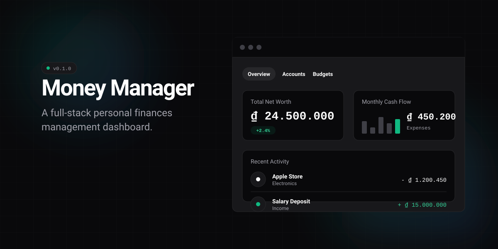

A full-stack personal finance management dashboard designed to track income and expenses, manage budgets, monitor savings goals, and gain clear insights into overall financial health.

  

## Tech Stack

- **Framework**: Next.js 16 (App Router, Server Actions, Server Components)
- **Database**: PostgreSQL, Drizzle ORM
- **Auth**: Better Auth (Authentication + Email verification)
- **UI**: Tailwind CSS v4, Base UI, Radix UI
- **Visualization**: Recharts, Number Flow
- **Motion**: Framer Motion, GSAP

## Design Decisions

- **Server-First Execution**: Data is fetched on the server using Server Components. Client bundles stay lightweight, improving Time to First Byte without showing loading spinners on the initial render.
- **Parallel Streaming**: Dashboard charts kick off queries at the top level and pass promises to `Suspense` boundaries, letting each chart resolve and hydrate independently.
- **Atomic Operations**: Money transfers (like funding goals) use PostgreSQL transactions to keep data consistent across multiple tables.
- **Database Truth**: Data integrity is enforced through PostgreSQL `CHECK` constraints and `UNIQUE` indexes, rather than relying solely on application-level Zod schemas.
